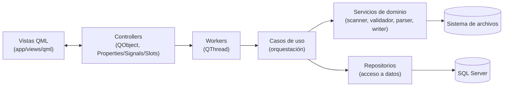

# Arquitectura

La app sigue una arquitectura por capas, con una convención consistente por cada
funcionalidad ("feature"). Actualmente hay dos features: **Renombramiento de soportes** y
**Separación de FURIPS**.

## Capas (de afuera hacia adentro)

### 1. Vistas QML — `app/views/qml/`
Interfaz gráfica (Qt Quick). Componentes genéricos reutilizables entre features:
`PrimaryButton`, `SecondaryButton`, `IndicatorCard`, `ProcesandoOverlay`, `StatusBadge`,
`Theme` (singleton de estilos), `ConfirmarBorradoDialog` (genérico, con `mensaje`
parametrizable).

Cada feature tiene su propio conjunto de archivos QML:
`<Feature>View.qml`, `NuevoProceso<Feature>Dialog.qml`,
`Confirmacion<Feature>Dialog.qml`, `Resultado<Feature>Dialog.qml`,
`<Feature>ResultsTable.qml`.

La navegación entre vistas la maneja `Sidebar.qml` (emite `vistaSeleccionada`) y
`AppShell.qml` (mantiene el estado `vistaActual` y muestra la vista activa con
`visible: vistaActual === "id"`; como los `Layout` de QML excluyen automáticamente los
hijos invisibles, ambas vistas coexisten sin perder su estado al cambiar de pestaña).

Todas las vistas usan `AppCtl.appName` / `AppCtl.clinicName` / `AppCtl.appVersion` en vez
de literales hardcodeados — la única fuente de verdad es `AppConfig`
([app/config/settings.py](../app/config/settings.py)).

### 2. Controllers — `app/controllers/`
Clases `QObject` expuestas a QML mediante `engine.rootContext().setContextProperty(...)`
en [main.py](../main.py) (convención de nombre: `<Feature>Ctl`, ej. `RenombrarCtl`,
`SeparacionFuripsCtl`). Exponen:
- **Properties** con su `Signal` de cambio (ej. `procesando`, `resultados`, `progresoActual`).
- **Slots** invocables desde QML (ej. `seleccionarCarpeta`, `analizar`, `ejecutarRenombrado`,
  `borrarTodo`).

No contienen lógica de negocio: delegan el trabajo pesado a un **worker** para no bloquear
la interfaz.

### 3. Workers — `app/controllers/workers.py`
Un `QThread` por feature (`ProcesoRenombramientoWorker`, `ProcesoSeparacionFuripsWorker`)
que ejecuta el caso de uso correspondiente en segundo plano y emite señales `progreso`,
`finished_ok` y `finished_error` de vuelta al controller (y de ahí a la UI).

### 4. Casos de uso — `app/use_cases/`
`ProcesarRenombramientoUseCase` y `ProcesarSeparacionFuripsUseCase` orquestan el flujo
completo de cada feature. Ambos exponen dos métodos simétricos:
- **`analizar(...)`**: hace todo el análisis y validación, pero no toca el sistema de
  archivos (solo "simula" para mostrar la tabla de resultados al usuario).
- **`renombrar(...)` / `separar(...)`**: repite exactamente el mismo análisis y, además,
  ejecuta la acción real (renombrar archivos/carpetas, o crear carpetas y escribir
  archivos).

Ambos aceptan un callback `on_progreso(actual, total, mensaje)` para reportar avance.

### 5. Servicios de dominio — `app/services/`
Lógica de negocio pura, sin dependencias de Qt:
- `services/processors/carpeta_scanner.py`: detecta subcarpetas + PDFs (Renombramiento).
- `services/furips/scanner.py`, `parser.py`, `writer.py`: detectan archivos FURIPS1/2,
  los parsean por número de factura (Strategy + Factory) y escriben los archivos separados.
- `services/empresas/`: reglas de validación y renombrado por empresa/EPS (ver
  [05-empresas.md](05-empresas.md)).
- `services/csv/factura_csv_source.py`: fuente alternativa de datos de factura (en vez de
  la base de datos), usada en la modalidad CSV de Renombramiento de soportes.
- `services/database/connection.py`: conexión a SQL Server vía `pyodbc`.
- `services/update/update_checker.py`: verificación de nuevas versiones en GitHub Releases.

### 6. Repositorios — `app/repositories/`
`FacturaRepository` encapsula la consulta SQL que resuelve los datos de factura a partir
de un número de admisión (ver [04-funcionalidades.md](04-funcionalidades.md)).

### 7. Modelos — `app/models/`
`dataclasses` de dominio. Cada resultado agregado (`ResultadoProceso`,
`ResultadoSeparacion`) y cada fila (`ResultadoSubcarpeta`, `ResultadoFactura`) implementa
`a_diccionario()` para exponerse como fila de tabla en QML.

### 8. Configuración — `app/config/`
- `settings.py`: `AppConfig` (singleton) carga el `.env` y expone `DatabaseSettings`.
- `paths.py`: `resource_path()` resuelve rutas de recursos (QML, imágenes) tanto en
  desarrollo como empaquetado (`sys._MEIPASS`).
- `logging_config.py`: logging rotativo a archivo + captura de excepciones no controladas.

## Punto de entrada — `main.py`

1. Crea `AppConfig()` y configura el logging.
2. Crea el `QGuiApplication` y el `QQmlApplicationEngine`.
3. Instancia los tres controllers (`AppController`, `RenombrarController`,
   `SeparacionFuripsController`) y los registra como *context properties* (`AppCtl`,
   `RenombrarCtl`, `SeparacionFuripsCtl`).
4. Carga `app/views/qml/main.qml`.

## Principio general de extensión

Agregar una **empresa/EPS** nueva no requiere tocar código de lógica: solo se agrega una
entrada de datos en `registro_empresas.py` (ver [05-empresas.md](05-empresas.md)). Agregar
una **funcionalidad** nueva implica replicar el mismo patrón de capas descrito arriba
(modelo → servicio → caso de uso → worker → controller → vistas QML).
